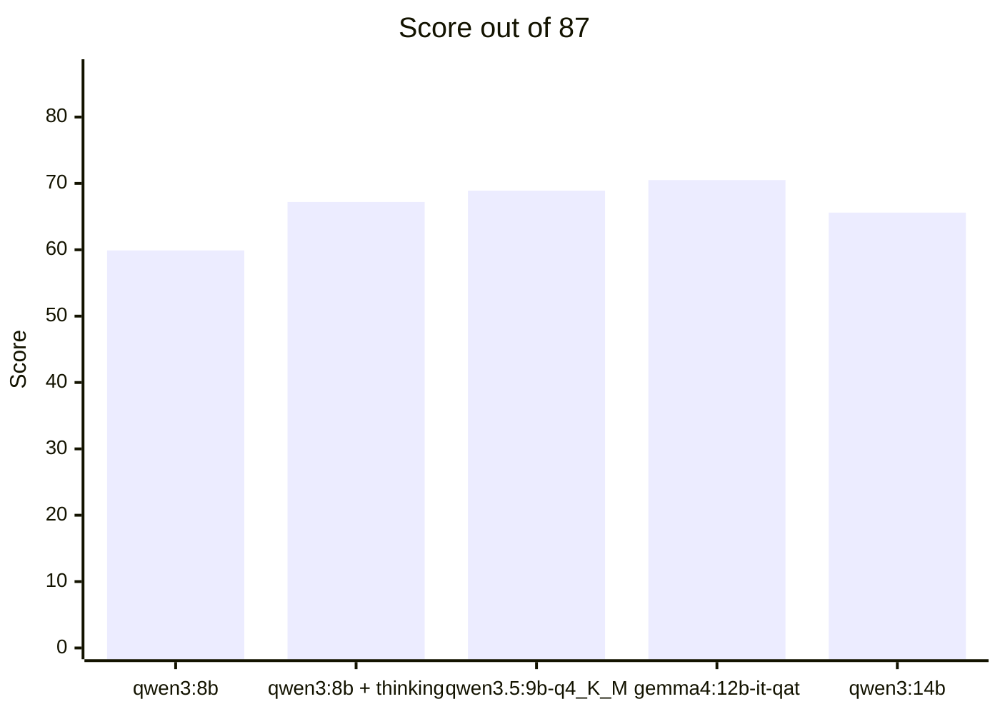
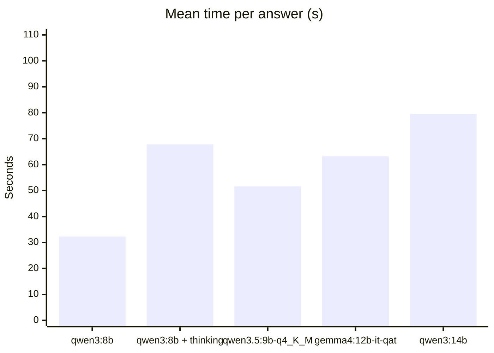

# Benchmarks

How well the agent answers questions about a project, measured on a real one, to choose the models and to check that a change to the answering pipeline helps. Each entry gives its date, what was compared and what was kept. The questions and answers are not published: they quote a private knowledge base.

## Method

- **Project**: a mobile game, its knowledge base (about 70 Markdown pages in French: mechanics, roadmap with status tags, decision records, reference values, mockups) and two code repositories (a Flutter app and a Symfony server).
- **Questions**: 29 questions with a checked answer, each asked in 3 phrasings (87 in all), as a participant would say them ("Otis, …"). A small model's answer can change with one word of the question, or of the prompt: a change counts only when it holds across phrasings.

  | Category | Questions | What it tests |
  |---|---|---|
  | Lists | 5 | every row of a table (mini-games, player states, item types), a count |
  | Reference values | 8 | one value in the page that holds them (`authoritative`) |
  | Decisions and statuses | 5 | a decision record, a planned or rejected item |
  | Vocabulary and organisation | 3 | in-game names, where documents live |
  | Mockups | 3 | what a screen shows, from the alt texts |
  | Code | 4 | which class or file does something |
  | Out of the KB | 1 | the agent must say it does not know |

- **Scoring**: an answer scores 1 when it holds the expected value; a list scores the share of expected items it names; the out-of-KB question scores 1 only for the "not covered" reply.
- **Pipeline**: the real `answer_question`, with the KB conventions loaded as `sync()` loads them (glossary, `authoritative` boost, `exclude`, `unexpanded_sections`). No meeting context.
- **Machine**: Mac mini, 16 GB, Ollama 0.40.6, `temperature: 0` (answers are reproducible from one run to the next), embeddings `bge-m3`.
- **Time**: from the question to the reply, both model calls included.

The expected answers follow the knowledge base: they are checked again before each campaign, so scores from two campaigns are comparable only when the knowledge base did not change in between.

## 2026-11 — Models

Knowledge base of 2026-11-23. The roles are measured separately: `strong` (writes the answer) with `fast` fixed to `qwen3:8b`, then `fast` (rewrites the question into search queries) with the best `strong`.

### `strong`

| `strong` | Score /87 | % | Mean time | Median | 90th percentile | Errors |
|---|---|---|---|---|---|---|
| qwen3:8b | 59.87 | 69 % | 32.3 s | 32.8 s | 47.6 s | 0 |
| qwen3:8b + thinking | 67.22 | 77 % | 67.8 s | 57.6 s | 85.8 s | 0 |
| qwen3.5:9b-q4_K_M | 68.85 | 79 % | 51.6 s | 52.3 s | 66.3 s | 0 |
| gemma4:12b-it-qat | 70.51 | 81 % | 63.2 s | 63.3 s | 81.4 s | 0 |
| qwen3:14b | 65.63 | 75 % | 79.6 s | 81.6 s | 105.6 s | 0 |

| Category | qwen3:8b | qwen3:8b + thinking | qwen3.5:9b-q4_K_M | gemma4:12b-it-qat | qwen3:14b |
|---|---|---|---|---|---|
| Lists | 6.9/15 | 8.2/15 | 8.9/15 | 10.5/15 | 7.6/15 |
| Reference values | 14.0/24 | 16.0/24 | 16.0/24 | 16.0/24 | 17.0/24 |
| Decisions and statuses | 13.0/15 | 14.0/15 | 14.0/15 | 14.0/15 | 13.0/15 |
| Vocabulary and organisation | 9.0/9 | 9.0/9 | 9.0/9 | 9.0/9 | 9.0/9 |
| Mockups | 9.0/9 | 9.0/9 | 9.0/9 | 9.0/9 | 9.0/9 |
| Code | 5.0/12 | 8.0/12 | 9.0/12 | 9.0/12 | 7.0/12 |
| Out of the KB | 3.0/3 | 3.0/3 | 3.0/3 | 3.0/3 | 3.0/3 |

`fast` is `qwen3:8b` without thinking in every row; `+ thinking` is `reasoning_effort: "medium"` on `strong`.

The baseline is lower than October's (69 % against 90 %): the knowledge base grew harder, not the agent worse. Lists now have 17 rows (the roadmap section is past `SECTION_MAX_CHARS`, so only its first chunk is read), and two default values became per-level tables, which `qwen3:8b` answers with an invented single value.

Thinking on `strong` is the largest gain so far, at twice the time: a minute per answer in a meeting.

`qwen3.5:9b` and `qwen3.5:4b` default to an `nvfp4` build, which Ollama 0.40.6 serves without structured output (`501 structured output is unavailable`): the agent cannot use it. Their `q4_K_M` builds are measured instead.

`gemma4:12b-it-qat` scores best so far, without thinking, and most of its lead is on lists and code. Its time here is not its own: `fast` (`qwen3:8b`) and `strong` (`gemma4`) do not fit in memory together, so Ollama reloads one model per call. Its real time is measured with `gemma4` in both roles.

`qwen3:14b`, measured as a ceiling (it does not fit in a 16 GB meeting), scores below `gemma4:12b`: size alone is not the lever.

`qwen3.5:9b-q4_K_M` without thinking comes second, ahead of `qwen3:8b` with thinking.

_Still to run: qwen3.5:9b-q4_K_M + thinking._

### Memory

On 16 GB, a meeting holds the language model, `bge-m3`, the transcription model and, for Meet and Slack, Chromium. `fast` and `strong` are best served by the same model: two different ones are unloaded and reloaded in turn.

_In progress._

## 2026-10 — Excerpts and query rewriting

Knowledge base of 2026-10-24, `qwen3:8b` for both roles, without thinking (`reasoning_effort: "none"`). The expected answers of that campaign differ from November's (the knowledge base grew from 11 to 17 mini-games in production): these scores are not comparable with the ones above.

| Change | Score /87 | Kept |
|---|---|---|
| Baseline (`main` of 2026-10-24) | 78.04 | — |
| `unexpanded_sections: ['^Maquette']`: a mockup gallery is no longer read whole | 77.95 | yes: same score with 10 % fewer excerpt characters ([#23](https://github.com/sdeparte/kb-meeting-agent/pull/23)) |
| A query-rewriting hint naming what a question about the code asks (file, class, widget…) | 74.18 | no: detected code questions better (4 errors in 37 → 0) but changed every question's queries, losing 5 answers for 2 won |
| Both | 73.18 | — |

Also tried on the 29 questions alone, and dropped:

- Adding, for each identifier an excerpt cites, its row of the reference-values page: no gain, 3 % more characters.
- Searching the code as a last resort when the knowledge base does not answer: the model flagged a complete, correct answer as not covered, and an old audit report in a code repository then gave a wrong one.
- Ordering excerpts by fused rank instead of query order, expanding only the first sections, stripping link URLs: within the noise, or worse on lists.

Lessons:

- **Measure with the conventions loaded.** A harness that skipped `sync()` ran without the glossary and the `authoritative` boost, and scored 3 questions lower than the agent really does.
- **One phrasing is not enough.** With 29 questions, two prompts that differ by one sentence swapped 3 or 4 answers each way; only the 87-question set told a loss from noise.
- **Known failure: lists filtered by status.** "Which mini-games are planned?" fails: the roadmap section is longer than `SECTION_MAX_CHARS` (6,000), so only its first chunk is read, and given the whole table `qwen3:8b` lists every row as planned.
